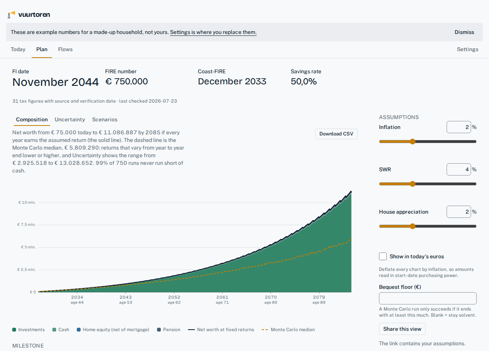

# Vuurtoren

[](https://github.com/simonvanlierde/vuurtoren/actions/workflows/ci.yml)
[](LICENSE)
[](https://app.codspeed.io/simonvanlierde/vuurtoren?utm_source=badge)

A self-hosted FIRE and net-worth projection planner with a correct Dutch tax engine.

Most projection tools (ProjectionLab, Boldin) model US tax, and most portfolio trackers
(Ghostfolio) don't project. Vuurtoren does both, for a Dutch household: Box 3 under the
forfaitair regime and the *Wet werkelijk rendement* scheduled for 2028, the *tegenbewijs*,
mortgage interest deduction net of the eigenwoningforfait and Wet Hillen, transfer tax with
the starter exemption, and Box 3 split across fiscal partners. Every tax figure is dated
and cites its source.



## Local-first

Your plan lives in a SQLite file on your machine. There is no account, no cloud and no
subscription. The same Python engine also compiles to WebAssembly, so there is a
zero-install browser build that runs entirely client-side: your household numbers never
leave the page. Its only outside request is the Pyodide Python runtime, downloaded once
from cdn.jsdelivr.net; the engine and its dependencies come from the site itself. You keep
your work by exporting a JSON file and importing it back. Live price refresh is the one
thing it can't do without a server.

**[Try the demo in your browser →](https://simonvanlierde.github.io/vuurtoren/)** It runs a
made-up example household, and the first start downloads about 20 MB.

## Quick start

Requires [uv](https://docs.astral.sh/uv/), Python 3.14, Node 26 or newer and [pnpm](https://pnpm.io/).

```bash
uv sync
pnpm -C frontend install
pnpm -C frontend build     # build the UI into the app's static mount
uv run vuurtoren           # serves the app at http://127.0.0.1:8000
```

For a live-reloading UI, run `uv run vuurtoren` and `pnpm -C frontend dev` side by side.
The browser build is `pnpm -C frontend build:browser`, with static output in
`src/vuurtoren/static`. `just --list` shows the wrapped commands.

Start empty and create your household in the UI, or seed it from a TOML file:

```bash
mkdir -p data && cp household.example.toml data/household.toml   # then add your holdings
uv run python -m vuurtoren.seed
```

`data/household.toml` is gitignored. Nothing about a real household is ever committed.

## More

- [CONTRIBUTING.md](CONTRIBUTING.md): the checks, the architecture rules, adding a country.
- [CHANGELOG.md](CHANGELOG.md): what each release changed.
- [docs/decisions.md](docs/decisions.md): what was decided and why, including what is deliberately not built. The Plan surface lists the tax engine's known gaps.
- [PRODUCT.md](PRODUCT.md) and [DESIGN.md](DESIGN.md): who it is for and how it looks.

## Licence

[MIT](LICENSE).
