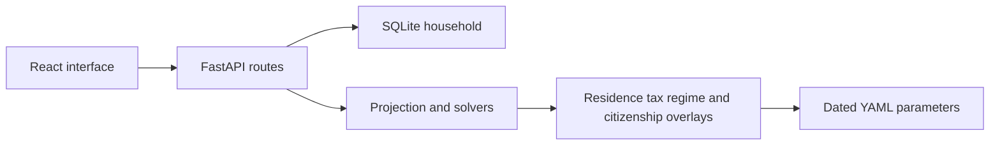

# How Vuurtoren works

Vuurtoren runs the same Python application in two places: a local server and a Pyodide browser worker.
The React interface calls the FastAPI routes in both builds.

The server stores SQLite on disk. The browser worker stores it in memory; export JSON keeps a plan between visits.
Only the server refreshes live prices. The browser downloads its Python runtime from jsDelivr and its other assets from the site.
The browser client queues requests because the worker runs Python on one thread.

`domain.py` holds the engine input and has no storage dependencies.
`tables.py` maps SQLite rows to those values, and Alembic upgrades stored schemas.
The engine handles monthly balances and returns without knowing the household's country.
The residence regime and citizenship overlays calculate tax using the dated parameter files.

[CONTRIBUTING.md](../CONTRIBUTING.md#architectural-invariants) defines the architecture rules and numeric boundaries.
[Tax coverage](tax-coverage.md) lists model limits and the source years of the shipped figures.
